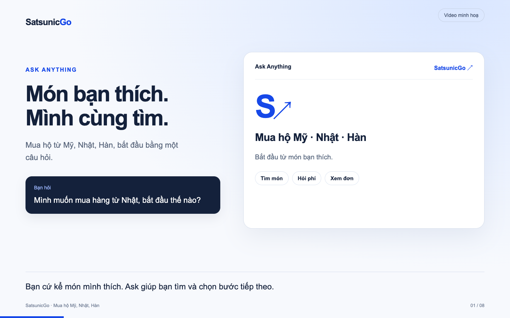
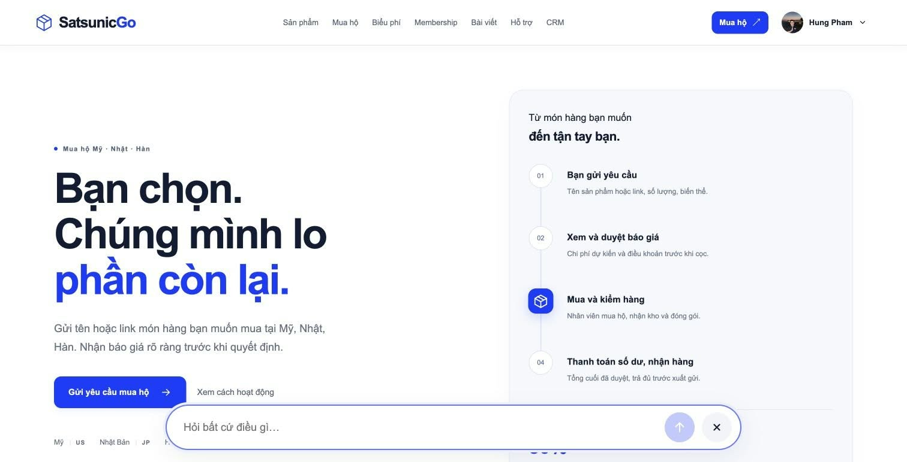

# SatsunicGo

**Overseas shopping, from the first question to order tracking.**

SatsunicGo helps customers in Vietnam buy products from the US, Japan, and South Korea. Browse listed products or request something new. **Ask Anything** connects product discovery, purchase details, service information, and order tracking in one conversation.

[Explore SatsunicGo](https://satsunicgo.web.app/) · [Watch the walkthrough](docs/assets/readme/ask-demo/ask-anything-demo.mp4) · [Local setup](#install-and-run) · [Architecture](docs/ARCHITECTURE_AND_DATA.md)

[](docs/assets/readme/ask-demo/ask-anything-demo.mp4)

*A 72-second Vietnamese product walkthrough with captions and illustrative data. This is a storyboard based on current source, rather than a recording of a completed transaction. [Transcript and demo notes](docs/assets/readme/ask-demo/README.md).*

## Ask Anything

Start with what you need. Keep the product pages, cart, and forms available when you want to check the details.

| You ask | The next step |
| --- | --- |
| “Find an AIRism shirt in SatsunicGo.” | Search listed products by name or purpose, then choose a result. |
| “Make it two, size M.” | Update a supported selection, review its variant and total, then confirm adding it to the cart. |
| “Find this product in Japan.” | When external discovery is enabled and you are signed in, see reference sources in a selection panel. |
| “Use this source, in white.” | Select a source, variant, and quantity to prepare a custom purchase draft; review and complete the request form. |
| “What are the service fees?” | Get guidance grounded in published service information and links to the fee pages. |
| “Where is my order?” | Look up orders you can access, or use the supported guest tracking-code flow. |

**You stay in control.** A draft is not a submitted order. Catalog prices are checked again when items enter the cart. New checkout requires full initial payment of the displayed amount. Existing orders retain their recorded payment workflow. Payment confirmation and order progress come from backend records, never from generated chat text.

**Availability matters.** External discovery depends on frontend enablement, server policy, provider access, and a signed-in conversation. Web references do not confirm price, stock, or authenticity. A limited search with no matches does not prove the full catalog has no suitable product. When a lookup cannot be verified, use the catalog, request form, or support path.

## One service, two ways to shop

- **Listed products:** choose a variant and quantity, review the cart and recipient, and complete checkout.
- **Custom purchase assistance:** describe an item, share a link or reference image, or select a seller reference. Review the prepared details and provide missing source and price information before continuing.

The customer account brings together orders, payments, notifications, membership, and support. The staff workspace supports request review, purchasing, inspection, packing, shipping, and finance operations.



## Built around business actions

| Layer | Implementation |
| --- | --- |
| Web application | React 19, TypeScript, Vite, React Router |
| Identity and data | Firebase Authentication, Firestore, Storage |
| Business services | Firebase Cloud Functions v2 and shared domain validation |
| AI and discovery | Genkit / Gemini integration, bounded lexical knowledge retrieval, catalog and external-reference flows |
| Payments | payOS integration and SePay purchase checkout paths; environment-specific setup and acceptance required |
| Validation | Vitest, Firebase Security Rules checks, HTTP scenarios, Playwright browser coverage |

The server enforces ownership, permissions, validation, and transaction rules. Ask supplies explanations and prepares supported actions; application controls handle confirmation and checkout. Current retrieval uses bounded lexical search rather than a vector database.

This README describes the current working tree, including ongoing changes. The walkthrough and local development evidence do not certify production authentication, AI providers, payment settlement, or fulfillment. See [external setup](docs/EXTERNAL_SETUP_REQUIRED.md) and [operations](docs/OPERATIONS_RUNBOOK.md) for environment requirements.

## Repository guide

| Path | Contents |
| --- | --- |
| `src/` | Public website, customer account, Ask, cart, and staff workspace |
| `functions/src/` | Business commands, integrations, AI services, and jobs |
| `packages/domain/` | Shared schemas, pricing, order lifecycle, and domain rules |
| `tests/` | Unit, Security Rules, HTTP, and browser checks |
| `scripts/` | Local utilities, demo tools, and release checks |
| `docs/` | Architecture, workflows, operating notes, and review evidence |

Read the [product workflows](docs/PRODUCT_AND_WORKFLOWS.md), [architecture and data boundaries](docs/ARCHITECTURE_AND_DATA.md), [release guide](docs/releases/CICD-108.md), and [repository instructions](AGENTS.md). The [project story](https://hunpeolabs.com/resources/blog/satsunicgo-building-an-applied-ai-shopping-product) explains why I built SatsunicGo.

## Install and run

### Requirements

- Node.js **22** and npm, matching the Functions runtime and CI.
- Java **21 or newer** when running Firebase emulators.
- Git. Firebase CLI is included in the project's development dependencies.

### Install

```bash
git clone https://github.com/phamhungptithcm/SatsunicGo.git
cd SatsunicGo
npm ci
```

The root npm workspace installs the frontend and Functions dependencies together.

### Configure local development

For a fresh checkout, create `.env.local` with these demo values. Keep an existing local configuration if one is already in use.

```dotenv
VITE_FIREBASE_API_KEY=demo-only
VITE_FIREBASE_AUTH_DOMAIN=demo-satsunicgo.firebaseapp.com
VITE_FIREBASE_PROJECT_ID=demo-satsunicgo
VITE_FIREBASE_APP_ID=demo-only-app
VITE_FIREBASE_STORAGE_BUCKET=demo-satsunicgo.appspot.com
VITE_FIREBASE_REGION=asia-southeast1
VITE_USE_EMULATORS=true
VITE_AUTH_EMULATOR_PORT=19207
VITE_FIRESTORE_EMULATOR_PORT=18207
VITE_FUNCTIONS_EMULATOR_PORT=15207
VITE_GOOGLE_CLIENT_ID=
VITE_RECAPTCHA_ENTERPRISE_SITE_KEY=
VITE_BETA_RELEASE=false
```

These are synthetic local values. `.env.local` is ignored by Git. For an authorised Firebase environment, [.env.example](.env.example) lists the browser configuration fields; payment credentials and other server secrets belong in the server's approved configuration.

### Run the frontend

The shared frontend is **http://127.0.0.1:5207**. Check whether it is already running before starting it. On macOS or Linux:

```bash
lsof -nP -iTCP:5207 -sTCP:LISTEN
```

If there is a listener, reuse that server. Otherwise, with the backend emulators running:

```bash
npm run dev -- --port 5207 --strictPort
```

Open **http://127.0.0.1:5207**. If the port is occupied, coordinate with the person using it; `--strictPort` keeps Vite from silently choosing another port.

### Start the backend on a fresh machine

Skip this step when using the team's running emulators. The shared configuration is `/private/tmp/satsunicgo-shared5207/firebase.json`, with Auth **19207**, Firestore **18207**, Functions **15207**, and Storage **19208**. Preserve demo data and coordinate any restart.

For a new local environment with those ports free, create an ignored config that points back to the repository's Functions and rules:

```bash
mkdir -p .ai/local
node --input-type=module <<'NODE'
import { readFileSync, writeFileSync } from 'node:fs';
import { resolve } from 'node:path';
const config = JSON.parse(readFileSync('firebase.json', 'utf8'));
const local = {
  functions: config.functions.map(({ predeploy, ...entry }) => ({
    ...entry, source: resolve(entry.source),
  })),
  firestore: {
    rules: resolve(config.firestore.rules),
    indexes: resolve(config.firestore.indexes),
  },
  storage: { rules: resolve(config.storage.rules) },
  emulators: {
    auth: { host: '127.0.0.1', port: 19207 },
    firestore: { host: '127.0.0.1', port: 18207, websocketPort: 18208 },
    functions: { host: '127.0.0.1', port: 15207 },
    storage: { host: '127.0.0.1', port: 19208 },
    hub: { host: '127.0.0.1', port: 14207 },
    logging: { host: '127.0.0.1', port: 14208 },
    eventarc: { host: '127.0.0.1', port: 19209 },
    tasks: { host: '127.0.0.1', port: 19210 },
    ui: { enabled: false },
    singleProjectMode: true,
  },
};
writeFileSync('.ai/local/firebase.demo.json', JSON.stringify(local, null, 2));
NODE
npm run build --workspace functions
npx firebase emulators:start --project demo-satsunicgo \
  --config .ai/local/firebase.demo.json --only auth,firestore,functions,storage
```

Leave the emulators running in that terminal, then start the frontend in another. Fresh emulators contain no team fixtures; use an approved demo export if you need the existing accounts and orders. The older `dev:demo` and seeding scripts use different fixed ports, so they are not the startup path for this shared environment.

### Check and build

```bash
npm run typecheck
npm run lint
npm test
npm run build --workspace functions
```

For a frontend-only beta build with Firebase client services disabled:

```bash
VITE_USE_EMULATORS=false VITE_BETA_RELEASE=true npm run build
```

For a connected build, use your authorised browser configuration with `VITE_USE_EMULATORS=false` and `VITE_BETA_RELEASE=false`, then run `npm run build`. Emulator mode is development-only.

The frontend build produces `dist/` and regenerates the public asset manifest used by Functions. These commands do not deploy anything.

`npm run test:rules`, `npm run test:http`, and `npm run test:restore` start isolated test emulators on the legacy ports in `firebase.json`. Run them in a coordinated test environment with those ports free. They can create and clean up fixture data; they should not target emulators someone is using for a demo.
