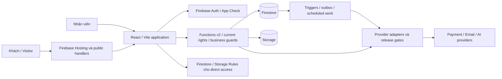

# Thiết kế tổng thể hệ thống

SatsunicGo • Phiên bản 1.1 • 10/10/2026

## Các thành phần

Trình duyệt sử dụng ứng dụng React và các trang công khai do Hosting/Functions phục vụ. Firebase Auth xác minh danh tính; App Check hỗ trợ kiểm soát nguồn gọi. Functions thực hiện kiểm tra quyền và nghiệp vụ trước khi ghi Firestore hoặc xử lý Storage. Sự kiện dữ liệu và hàng đợi kích hoạt các tiến trình nền khi điều kiện cho phép.

Thanh toán, email và AI nằm ngoài ranh giới cơ sở dữ liệu. Kết nối với các nhà cung cấp phải có cấu hình, quyền và trạng thái nghiệm thu riêng. Không coi mọi đường trong sơ đồ là đã bật ở production.

## Lựa chọn kiến trúc

Thư viện nghiệp vụ dùng chung giúp thống nhất phép tính và điều kiện giữa các lớp. Giao dịch Firestore ràng buộc phiên bản, kết quả thao tác, nhật ký và dữ liệu liên quan. Bản chụp giá/điều khoản giữ lịch sử đã được chấp nhận.

Tách dữ liệu khách và dữ liệu nội bộ giảm phạm vi thông tin được trả. Đổi lại, các bản dữ liệu phục vụ hiển thị cần được kiểm tra độ cập nhật, đúng chủ sở hữu và cách đồng bộ.

## Ranh giới tin cậy

Dữ liệu từ trình duyệt, nội dung web và kết quả AI không đáng tin mặc định. Đăng nhập không thay kiểm tra chủ đơn; App Check không thay kiểm tra vai trò. Chữ ký phản hồi thanh toán không thay kiểm tra số tiền và ngữ cảnh.

Giao dịch cơ sở dữ liệu không thể đồng thời bảo đảm nhà cung cấp chưa hoặc đã thực hiện lệnh. Mất phản hồi sau khi gửi có thể tạo kết quả chưa xác định; cần đường đối soát thay vì gửi lại mù.

## Khả năng mở rộng

Nguồn có truy vấn giới hạn và cấu hình số phiên xử lý theo hàm. Năng lực tải thực tế chưa được chứng nhận. Cần đo truy cập công khai, ghi checkout, truy vấn theo dõi, tranh chấp dữ liệu và hàng đợi nền. Mô hình nhiều tenant, tích hợp carrier tự động và dự phòng đa vùng cần thiết kế riêng.

## Sơ đồ thành phần

