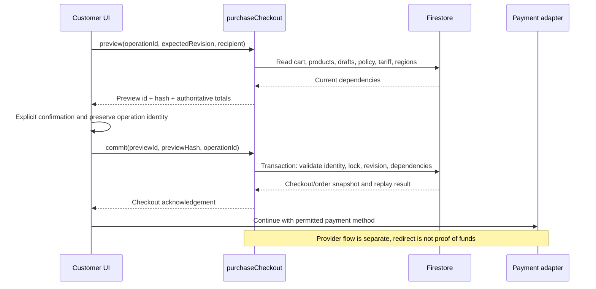

# Thiết kế chi tiết hệ thống

SatsunicGo • Phiên bản 1.1 • 10/10/2026

## Chuẩn bị và chốt checkout

Bản xem trước được tạo từ phiên bản giỏ, sản phẩm, bản nháp, địa chỉ, chính sách, biểu cước và dữ liệu khu vực hiện tại. Máy chủ tính tổng; trình duyệt không được quyết định giá. Khi chốt, hệ thống nhận `previewId`, `previewHash`, `operationId` và xác nhận của khách, rồi kiểm tra lại các điều kiện trong giao dịch.

Nhánh niêm yết tạo đơn từ giá chính thức của sản phẩm. Nhánh yêu cầu riêng thanh toán trước kiểm chủ bản nháp và độ khớp của dòng hàng, sau đó lưu giá nguồn, tỷ giá, phí và chính sách vào dữ liệu lịch sử. Ảnh chưa xử lý xong có thể chặn bước xem tổng quan theo hợp đồng hiện tại.

## Đồng thời và gửi lại

Revision và `expectedVersion` phát hiện người ghi đang dùng dữ liệu cũ. Mã thao tác cùng nội dung cho phép nhận lại kết quả cũ; đổi nội dung phải dùng quy trình mới phù hợp. Trình duyệt giữ lần gửi đang chờ trong phạm vi phiên của tab. Dữ liệu này không thay nguồn chính thức trên máy chủ.

Cần kiểm thử hai tab, bấm hai lần, thay giỏ giữa xem và chốt, khóa tài khoản, chính sách hết hạn và mất phản hồi sau commit. Kết quả cuối phải không tạo trùng đơn hoặc tiền.

## Tiền, kiện và thông báo

Xác nhận khoản thu gắn mã ngân hàng duy nhất, phiên bản đơn và bút toán. Phần tiền dành cho hoàn ảnh hưởng tiền khả dụng. Phân bổ kiện kiểm số lượng theo từng dòng; điều kiện xuất gửi xét toàn bộ đơn liên quan.

Thông báo nền cần đọc lại người nhận, lựa chọn liên lạc, trạng thái khóa và chính sách trước khi gửi. Nhà cung cấp đã nhận lệnh chưa chứng minh người nhận đã nhận thư. Kết quả chưa xác định được giữ để đối soát.

## Lỗi và khôi phục

Lỗi dữ liệu yêu cầu sửa đầu vào. Lỗi quyền yêu cầu kiểm phiên/quyền mà không làm lộ dữ liệu. Xung đột cần đọc lại trạng thái mới. Mất phản hồi cần kiểm tra cùng lần gửi. Từng API có mã lỗi riêng trong chương hợp đồng; không áp một cách xử lý chung cho mọi trường hợp.

## Trình tự checkout

