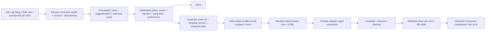

# CUSTOMER-EMAILS-20261009-v1 — kế hoạch tích hợp để duyệt

Status: **PROPOSED / AWAITING HUMAN APPROVAL**. Created 2026-10-09, America/Chicago. Baseline commit `0d6e721698608eebb36b0b2f68021c3054d97d1c`. Shared dirty worktree; source is changing concurrently. This document is not authorization to deploy, lift release holds, access secrets, or email customers.

## Kết quả cần đạt

42 mẫu tiếng Việt trong `TEMPLATES.vi.json`, câu chữ đầy đủ trong `EMAIL-COPY.md`, bản HTML xem trước trong `preview.html`. Mỗi mẫu có tiêu đề, preheader, nội dung, CTA, biến bắt buộc, nguồn nghiệp vụ, điều kiện gửi và chính sách kênh. Mẫu `in_app_only` không được gửi qua email mặc định. Các mẫu có guard chưa được triển khai phải bị chặn, không tự suy diễn trạng thái để dùng.

Phần được đề nghị duyệt: renderer `subject/text/html`, hợp đồng sự kiện và phân loại kênh, tích hợp với các nguồn nghiệp vụ đã có, kiểm thử lỗi và quan sát vận hành. Giữ nguyên số tiền, quyền, trạng thái nghiệp vụ, release holds và quy tắc đồng ý của khách. Chưa gửi thật hoặc bật email khách.

## Repository intelligence brief

- CodeGraph/CocoIndex gate vẫn `DEGRADED` sau một lần refresh ở lượt trước. Health/query có thể chạy nhưng freshness toàn worktree chưa được chứng minh.
- CodeGraph query đã trả cấu trúc của `deliverEmail`, `processPurchaseReceipt`, `notificationTarget`; có kết quả lẫn các bản sao compiled trong `output/`, đã loại khỏi căn cứ chính. CocoIndex tìm được contract/scenario docs về refund và outbox; không coi scenario ghi NOT_RUN là test đã chạy.
- Critical facts verified from canonical `functions/src`, `packages/domain`, `src/app/App.tsx`, rules/tests references. Shared architecture/glossary/ownership context còn là placeholder; không invent business owner hoặc SLA.
- Backend TypeScript, Node.js 22, Firebase Functions v2/Admin Firestore, Nodemailer, Zod; frontend React/TypeScript/Vite. Email provider integration is being prepared in the other user-authorized chat.
- Profiles selected for proposed implementation: universal, typescript-javascript, product-content, frontend-html-css, web-app, system-design, concurrency, database. Actual compile/rules/provider checks remain pending implementation.

## Hiện trạng và phần thiếu

| Đã kiểm tra từ source | Hệ quả |
| --- | --- |
| `index.ts` tạo outbox cho mọi domain action | Phải allowlist business event; không email claimPurchase/pack/internal approval chỉ vì có outbox |
| `jobs.ts` tạo inbox và queue email trong cùng maintenance job 30 phút | Inbox và email cần policy riêng; ưu tiên event-driven cho event mới, bounded recovery cho missed jobs |
| `email.ts` schedule 30 phút, SMTP claim + unknown/reconciliation | Không bỏ claim/late-result fence; không gọi SMTP trong Firestore transaction |
| `provider-release-gate.ts` không cho email | Giữ hold trong scope này; kích hoạt là bước được duyệt riêng |
| `purchase-settlement.ts` tạo receipt/PDF jobs, không tạo general outbox | Nối confirmed payment một lần theo checkout receipt, không theo từng line |
| `purchase-receipts.ts` có `purchaseEmailOutbox` riêng, demo_sink/unconfigured | Receipt ready và actual email delivered là hai kết quả khác nhau; hợp nhất delivery orchestration, giữ money independent |
| `purchase-adjustment.ts` lưu proposal/timeline, thiếu notification | Tạo event nguyên tử cùng proposal để khách biết cần duyệt |
| `setDeliveryEstimate` cố ý không tạo notification | Chỉ thêm sau khi có rule thay đổi đáng kể; không email mọi chỉnh sửa ETA |
| Refund request do staff có quyền tạo; execution ghi finance entry + evidence | Không viết “bạn vừa gửi” nếu không phải khách gửi; không khẳng định ngân hàng đã ghi có |
| Inbox `read` chỉ là đã đọc thông báo | Không dùng làm bằng chứng đã đọc tin nhắn hỗ trợ |
| Routes có `/account/orders/:id`, `/account/documents`, `/membership`, `/support` | Dùng route thật; receipt hiện nằm trong tài khoản/order, không đoán route PDF công khai |

## Biz flow và sự kiện

### Catalog / mua hộ thanh toán trước

1. Ask hoặc giỏ hàng chỉ chuẩn bị nhu cầu. Server kiểm tra sản phẩm, giá, phiên bản, người nhận và điều khoản. Chưa gửi “đã nhận tiền/đã mua” khi khách bấm nút hoặc browser quay về.
2. Backend đối chiếu provider và ghi allocation/ledger/receipt nguyên tử. Một `payment_confirmed` cho một khoản thanh toán, gồm các đơn liên quan. Scope copy được backend chọn từ `catalog_full`, `custom_initial`, `sourcing_difference`, `final_balance`, `mixed_checkout`; không nhận một câu `paymentScope` tùy ý từ client/LLM. Nếu scope hỗn hợp không thể tóm tắt chính xác, gửi dòng “Chi tiết phân bổ theo từng đơn nằm trong tài khoản.”
3. Khách mua hộ nhận lời cảm ơn đúng lúc. Catalog không được mô tả thành dịch vụ mua hộ nếu purchaseKind khác. Receipt PDF xong thì đính kèm hoặc link tới authenticated account; đừng giữ payment confirmation chờ PDF. Nếu PDF sẵn ngay có thể gộp email; nếu chưa sẵn, inbox receipt-ready mặc định, email riêng theo lựa chọn/yêu cầu để tránh 2 mail cho cùng khoản.
4. Giá mua tăng → lưu proposal → gửi `price_change_proposed` với exact revision và old/new totals. Khách mở app để đồng ý hoặc trao đổi; link email chỉ điều hướng. Đồng ý chưa phải trả thêm tiền. Mua tiếp theo điều kiện domain hiện tại, không theo việc email đã gửi.
5. Mua một phần/đủ, kho nhận một phần/đủ, hàng thiếu/hỏng có các event khác nhau. Chỉ exception cần quyết định mới ưu tiên email.
6. Final approved costs → `final_balance_due` nếu thiếu, `final_no_balance` nếu đủ, `excess_payment_review` nếu dư cần xử lý. Sử dụng hàm domain cho số dư; không tính lại bằng floating point trong template. `netPaid` phải mô tả đúng net collections; nếu refund reservation làm available amount khác net paid thì thêm dòng riêng hoặc chặn mẫu v1, không trình bày hai số như phép trừ đơn giản khi không đúng.
7. Actual carrier handoff → `shipment_dispatched`; carrier event thất bại/hoàn về/giao một phần/giao đủ chọn đúng mẫu. Dedup batch/parcel/order paths. Một parcel chứa nhiều đơn của cùng khách cần nhóm theo owner+parcel, chỉ hiển thị allocations của khách đó.
8. Cancelled khác refunded. Refund finance record có evidence chỉ cho phép `refund_recorded`; ngân hàng khách đã nhận tiền cần bằng chứng riêng, không suy ra từ ledger hoặc API accepted.

### Luồng báo giá cũ

`request_received → quote_ready → quote_accepted → payment_reported → payment_confirmed`. Giữ hỗ trợ nếu route còn dùng; không đưa quote/deposit vào flow upfront mới. Không gửi `order_received` unpaid nếu đơn chỉ được tạo sau verified checkout; payment confirmation đã xác nhận việc này.

### Hỗ trợ, Membership và account security

- Chỉ staff customer-visible message được tạo email; internal note/assignment đi CRM, không tới khách. Đề xuất grace period 5 phút cho unread, cần owner duyệt và server evidence `lastReadMessageVersion`. Nếu chưa có read model, dùng immediate single email theo conversation window có chủ đích hoặc giữ in-app; không giả vờ biết khách chưa đọc.
- Membership reminder chỉ theo approved settings hiện có, một lần mỗi subscription term; recheck gia hạn trước gửi. Không invent days-before hoặc quyền lợi thương mại.
- Account security thuộc Google/Firebase auth hiện tại; không tạo email “đổi mật khẩu SatsunicGO” khi app không có flow đó. Marketing/re-engagement/abandoned-cart nằm ngoài scope transactional và cần policy/preferences riêng.

## Backend/data flow đề nghị

Ask không có quyền trực tiếp gửi email hoặc tự xác nhận tiền/giao hàng. Email dùng domain event, không dùng chat transcript hoặc câu trả lời AI làm nguồn. Business event không đồng nghĩa analytics consent; không gắn tracking pixel/click rewrite vào transactional mail mặc định.

### Hợp đồng dữ liệu dự kiến

Server-only immutable event: `eventId`, `eventType`, `ownerId`, `entityId`, `entityVersion`, `occurredAt`, `templateId`, `templateVersion`, `locale`, `businessSnapshotHash`, `schemaVersion`, typed minimal payload. `ownerId` tra từ record có thẩm quyền, không từ client body.

Delivery: `jobId = hash(eventId + ownerId + channel)`; đổi templateVersion không tự tạo email mới cho event cũ. Snapshot template/version/body hash và recipient revision/hashed identity lúc claim. Nếu đổi email trong lúc pending, giữ job blocked cho đến resolve có chủ đích; không tự gửi lại vào địa chỉ khác sau uncertain outcome. `templateVersion` pin immutable để retry đúng body, không render lại nội dung tài chính khác dưới cùng provider key.

Schema riêng theo event; money là integer VND hoặc currency typed; dates epoch milliseconds + server locale formatter vi-VN/Asia/Ho_Chi_Minh cho audience VN, có nhãn giờ khi quan trọng. `orderRef` chỉ display reference server, không bịa mã mới làm identifier. `requiredFields` trong draft JSON mới là inventory, không thay thế runtime schema. `customerReason`, `nextStep`, `costImpact` chỉ được tạo từ approved enums/structured data hoặc staff-authored customer-safe fields có bounds; không trích note riêng, stack trace hay text LLM. `planName` là tên đầy đủ; template không tự thêm “Gói” gây lặp.

Unknown template/missing data/invalid currency/stale source → `blocked_render`, không gửi generic success fallback. Display formatter phân biệt zero/unknown/not-applicable. Old snapshot financial facts được diễn đạt tại thời điểm event; action-required event recheck trạng thái mới để suppress obsolete demand. Nếu đã gửi demand rồi trạng thái đổi, app luôn hiển thị trạng thái hiện tại và event xác nhận mới có priority.

### Bảo mật, lỗi và retry

- Verified active recipient from Auth; account lock and ownership recheck; no arbitrary to/from/HTML from client. Auth email verified không thay thế consent marketing hoặc deliverability suppression. Chặn bounced/complained recipients theo policy, vẫn giữ inbox và operator alert; không vô hiệu hóa quyền tài khoản vì email bounce.
- GET link chỉ điều hướng; acceptance/pay/refund thực hiện authenticated command có CSRF/session/App Check/version fences theo flow hiện tại. Link origin cấu hình allowlisted HTTPS; encode resource ID; không token PII hoặc URL tùy ý trong CTA.
- Escape toàn bộ text/attribute, reject CRLF header injection, bound field length, không render Markdown/raw HTML staff input. HTML shell không JavaScript, form, font remote, ảnh bắt buộc hoặc pixel. Plain text có same facts + destination URL.
- Claim trước network I/O, lease/claimId/version fence cho late completion. Crash giữa provider acceptance và local update → unknown; không đổi thành failed hoặc blindly resend. Reject chắc chắn là retryable thì backoff+jitter có cap. Operator reconciliation luôn role/MFA/evidence phù hợp.
- Resend idempotency hiện có cửa sổ 24h, nên durable ledger trong app vẫn bắt buộc; quá cửa sổ hoặc payload khác → reconcile thay vì đổi key để thử lại. SMTP adapter có thể dùng header idempotency được Resend tài liệu hóa; API/SMTP do thread provider chốt, không thêm SDK thứ hai chỉ cho template.
- Webhook verified signature, timestamp/replay bound, event ID dedup, map đúng provider message ID và claim, monotonic state transition cho duplicate/out-of-order. `accepted` không có nghĩa inbox người nhận đã thấy; `delivered` không phải opened/read. Không phụ thuộc open event để xác nhận khách đã đọc.
- Cutover timestamp + allowlisted event schema version: không tự email toàn bộ outbox lịch sử khi bật cấu hình. Old jobs cần explicit migration/review và suppress obsolete events. Recovery và event-driven cùng idempotency key, tránh hai sender độc lập cho purchaseEmailOutbox/outboxJobs.

## Performance và vận hành

- Business transaction không chờ renderer/PDF/SMTP; event ghi cùng transaction, send ngoài transaction. Không thêm LLM call để “viết hay” cho mỗi email.
- Chỉ đọc resource cần thiết; query indexed theo state/nextAttemptAt có limit/cursor; không quét toàn bộ users/orders mỗi tick. Kiểm tra indexes thực tế sau schema chốt.
- Start bounded concurrency (đề xuất 2–4 pending sends/process, còn phải đo và đối chiếu quota provider); maxInstances/cap theo quota, timeout và backpressure. Không fan-out toàn bộ batch trong request.
- Cached immutable templates; không import PDF/sharp/image pipeline cho email text-only. PDF generation giữ worker riêng, private storage/hash/size bound. Đề xuất HTML <50 KB mỗi email, không phải SLA hay giới hạn đã đo của mail client.
- Urgent payment/action-required priority cao hơn progress; scheduled recovery là safety net, không vòng 30 phút cho tất cả message. Đề xuất mục tiêu queue-to-provider dưới 60 giây khi tải bình thường, chỉ đặt SLA sau load/queue-age measurement.
- Metrics: queued age p50/p95, accepted/delivered/bounce/complaint, unknown/reconcile count, suppressed reason, render-blocked, attempts, stale leases. Logs chỉ IDs/hash/status/bounded error category; không email/body/recipient/financial payload.
- Rollback tắt new sender, giữ event/inbox/ledger và pending IDs; không xóa job hoặc retry bằng key mới. Never rollback payment/refund by deleting financial records.

## File/function implementation plan

| Path / function | Thay đổi đề nghị | Validation |
| --- | --- | --- |
| NEW `packages/domain/customer-notification.ts` | Typed event discriminated union, state-to-template/channel policy, customer-safe data projection | Exact schemas, unknown rejected, catalog/custom/mixed mapping, no secret/PII projection |
| `functions/src/email-content.ts` / `emailContent` | Deterministic renderer subject/text/html, HTML escape, locale values, typed payment scope, version pin | Snapshot/content semantics, hostile input, missing fields, long UTF-8, null vs zero |
| NEW `functions/src/customer-notification-events.ts` | Transactional event/job builder with deterministic keys; no network | Duplicate command, cross-process/replay/conflicting version, one receipt/multiple orders |
| `functions/src/index.ts` / domain command | Emit only approved business events, keep audit/timeline full | No staff noise; preserve rights/stage/financial invariants |
| `functions/src/purchase-settlement.ts` / `applySettlement` | Payment-confirmed event atomic with ledger/receipt | Duplicate IPN/readback, mixed cart, initial/balance, late payment, no double collection or double email |
| `functions/src/purchase-adjustment.ts` | Event for exact proposed version; approval acknowledgement in-app | Stale proposal, changed quote, unauthorized/locked, no spend authority from email |
| `functions/src/shipping.ts`, `consolidation.ts` | State-specific event; owner/parcel grouping; material ETA separate policy | Shared parcel, partial delivery, repeated scans, failure/returned, no cross-owner manifests |
| `functions/src/changes.ts`, `refunds.ts`, `finance-review.ts` | Versioned customer-safe change/refund/adjustment facts | Reservation/execution/cancel distinct, no bank-credit claim, correction amounts match ledger |
| `functions/src/order-conversation.ts`, `workspace.ts` | Public reply events only; unread grace requires read watermark in later approved slice | Notes never notify; staff/customer scopes; burst coalescing; no invented read evidence |
| `functions/src/membership.ts`, `jobs.ts` | Existing term events with expiry snapshot; policy split inbox/email; bounded recovery | Renew-before-send suppression, cursor starvation, duplicate worker, policy disable |
| `functions/src/purchase-receipts.ts` | Bridge document-ready to shared orchestration; retain private PDF worker | PDF failure doesn't revert money; one logical sender; ownership/document hash |
| `functions/src/email.ts`, `outbox-command.ts` | Coordinate provider thread's sender lease/reconcile with template contract | Accepted/unknown/delivered distinct, partial failure, stale claim, blocked recipient |
| `packages/domain/notification-content.ts`, `src/features/notifications/Notifications.tsx`, `src/features/content/notification-target.ts` | Customer-friendly labels and precise typed destinations; preserve read/retry | Current inbox UX/error/keyboard/mobile, invalid IDs, customer/staff separation |
| Firestore rules/indexes, Functions exports | Only if exact finalized job/read-watermark schema needs them; server-only default deny; no hold removal | Emulator rules deny direct writes, owner-scoped reads, query index acceptance |
| Tests under `tests/unit` and `tests/rules` | Add focused suites for renderer/event mapping/transaction delivery contracts | See scenarios below; no unrelated test rewrites |

Risk: HIGH for shared financial/event paths, MEDIUM for renderer only. Implementation should be sliced: A renderer + policy/fixtures; B transactional events/bridge + in-app; C provider trial jointly with other chat; D explicit customer activation after domain/deliverability/rollback acceptance. Plan approval may cover A+B only first; C/D require their own exact authorization and evidence. Dependencies, CI/release and production data migrations are out of this scope.

## Acceptance / test scenarios

1. All 42 content cases covered; subject/preheader/text/html agree; in-app-only event never dispatched by sender.
2. Upfront custom, catalog full, mixed checkout, sourcing difference, final balance select truthful amount scope; no invented shipping total.
3. Missing amount/currency, stale proposal, renewed membership, resolved payment review → block/suppress, never fallback success.
4. Concurrent retries/duplicate event/batch+parcel paths → one logical job, immutable payload and provider key; no extra financial write.
5. Unknown send, crash after provider acceptance, lease expires, late old worker → reconcile/fence; no blind retry after 24h.
6. Claimed recipient changed/locked/unverified; owner mismatched; private note included → blocked without leaks; no send to other parcel members.
7. Track in_transit/failed/returned/partial-delivered/fully-delivered choose correct wording; stale ETA never promised.
8. Refund request/cancel/recorded differ; final balance reserves preserved; no cancellation/refund side effect from opening email.
9. HTML/CRLF/control input, long item/reference, Unicode Vietnamese, plain-text-only client, images blocked, narrow 320/390 + desktop, keyboard filter/links and text scaling.
10. Sender-disabled/cutover existing backlog, bounded queue flood, provider 429/timeout/bounce/webhook duplicate/out-of-order tested with real implementation harness. Load and actual mail-client checks are required before production, not inferred from prototype.

## Coordination / authoritative sources

User authorized collaboration with the chat whose full title begins “Mình vừa có design này nhưng không phaei của mình mình muốn học để ứng dụng và vẽ lại cho satsunicgo…”. Thread ID `01a116b3-a055-7190-b275-a4461826678a`. Initial message sent assigning this task only draft artifacts in this directory; provider thread owns transport/test integration. No secrets or raw conversation stored here.

Reference design: `docs/designs/ask-agent-architecture/DESIGN.md`, explicitly a proposal. Reused its boundary: domain tools own state, Ask prepares/reads, notification outbox sits outside the model; customer behavior analysis is a separate consent-bound path. No claim that the design is already deployed.

Official docs checked 2026-10-09:

- [Resend idempotency](https://resend.com/docs/dashboard/emails/idempotency-keys): 24-hour provider window and SMTP header support; durable local receipt still required.
- [Resend webhooks](https://resend.com/docs/webhooks/introduction): asynchronous status handling; verify actual event contracts in provider implementation.
- [Firestore triggers](https://firebase.google.com/docs/functions/firestore-events): retries/ordering require idempotent consumer; no external send in retried transaction callback.

## Approval requested

Approve **CUSTOMER-EMAILS-20261009-v1 A+B**: renderer/policy plus transactional business-event and inbox integration, preserving all financial semantics and provider holds. Unread tracking/material ETA policies may remain disabled until separately decided. No customer emails, production activation, secret access, dependency change or deployment is included. A wider scope needs explicit delta approval.
